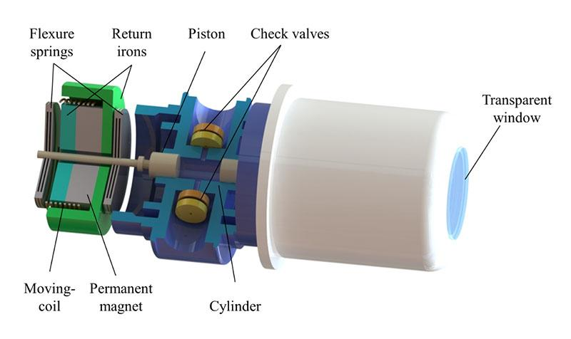
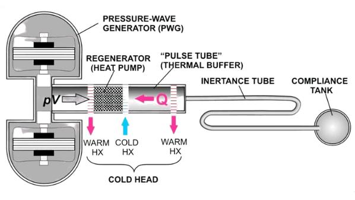
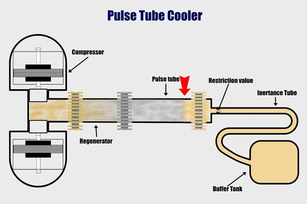
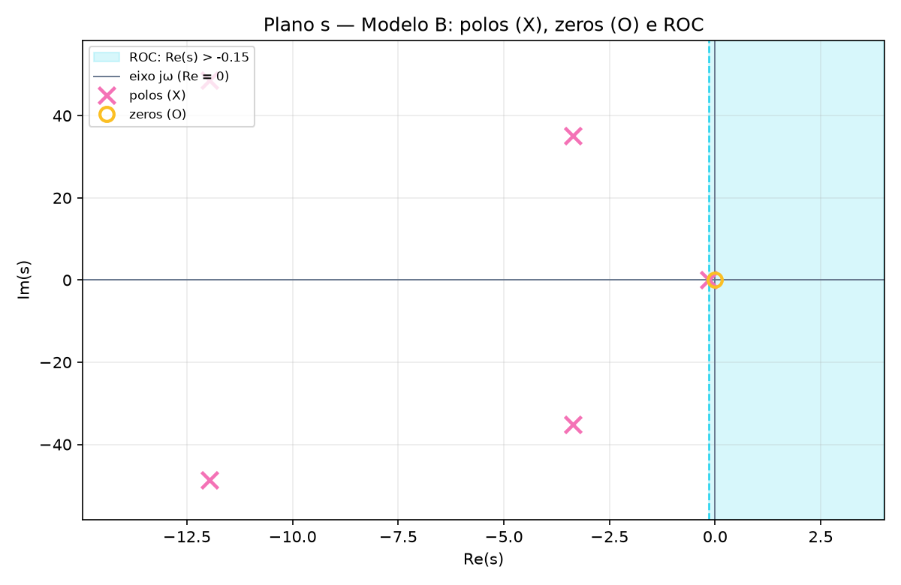

# Projeto 5 — Sistema de Refrigeração Criogênica por Pulso de Tubo

**Disciplina:** Sinais e Sistemas  
**Equipe:** Vinicius Fernandes, Marcos Menezes, Rafael Guerra, Rian Dutra, Leonardo Magalhães

Modelagem da entrada \(v_c(t)\) (tensão no compressor) até a saída \(T_f(t)\) (temperatura na extremidade fria) de um refrigerador criogênico de pulso de tubo (*Pulse Tube Cryocooler*) usado para resfriar sensores quânticos de satélites, sem vibrações espúrias.

---

## 1. Objetivo

Obter a função de transferência

\[
H(s)=\frac{T_f(s)}{V_c(s)}
\]

a partir das equações físicas dos três subsistemas em cadeia, e analisar seus polos, zeros, região de convergência (RDC/ROC) e estabilidade BIBO.

---

## 2. Subsistemas físicos

Ordem total \(2+2+1=5\): cinco estados independentes, logo a EDO final é de quinta ordem.

| # | Subsistema | Ordem | Estados |
|---|---|---|---|
| 1 | Compressor linear eletrodinâmico | 2 | \(x_p,\; v_p\) |
| 2 | Coluna de gás hélio | 2 | \(p_t,\; v_f\) |
| 3 | Regenerador térmico poroso | 1 | \(T_f\) |

Fluxo de sinais:

\[
v_c(t)\;\rightarrow\;\text{Compressor}\;(x_p,v_p)\;\rightarrow\;\text{Coluna de hélio}\;(p_t,v_f)\;\rightarrow\;\text{Regenerador}\;(T_f(t))
\]







---

## 3. Variáveis e parâmetros

| Símbolo | Significado | Unidade |
|---|---|---|
| \(x_p(t)\) | posição do pistão | m |
| \(v_p(t)\) | velocidade do pistão | m/s |
| \(p_t(t)\) | pressão acústica | Pa |
| \(v_f(t)\) | vazão volumétrica do gás | m³/s |
| \(T_f(t)\) | temperatura na extremidade fria | K |

Parâmetros oficiais:

| Parâmetro | Valor |
|---|---|
| \(C_{th}\) | 10 J/K |
| \(H_r\) | 1,5 W/K |
| \(L_f\) | 0,5 kg/m⁴ |
| \(R_f\) | 12 Ns/m⁵ |
| \(C_f\) | \(8{,}0\times10^{-4}\) m⁵/N |
| \(M_p\) | 1,2 kg |
| \(B_p\) | 8 Ns/m |
| \(K_p\) | 1500 N/m |
| \(A_p\) | 0,05 m² |
| \(K_{term}\) | 250 K/(m³/s) — *pendente de confirmação de unidade* |
| \(K_e\) | 5 N/V |

> Atenção: \(v_p\) (velocidade do pistão, m/s) não é \(v_f\) (vazão do gás, m³/s).

---

## 4. Equações do modelo

**Eq. 1 — pistão (2ª Lei de Newton):**

\[
M_p\frac{dv_p}{dt}+B_pv_p+K_px_p=K_ev_c-A_pp_t
\]

**Eq. 2 — cinemática:** \(v_p=\dfrac{dx_p}{dt}\).

**Eq. 3 — coluna de gás (inércia fluida):**

\[
L_f\frac{dv_f}{dt}+R_fv_f=p_t \qquad \text{(Modelo B, homogêneo)}
\]

A forma impressa no enunciado tem \(A_pp_t\) no lado direito (Modelo A), dimensionalmente não homogênea.

**Eq. 4 — compressibilidade:**

\[
C_f\frac{dp_t}{dt}=A_pv_p-v_f
\]

**Eq. 5 — regenerador (balanço de energia):**

\[
C_{th}\frac{dT_f}{dt}+H_rT_f=K_{term}v_f
\]

---

## 5. Eliminação das variáveis (operador \(D=d/dt\))

Com \(G(D)=C_{th}D+H_r\), \(Q(D)=M_pD^2+B_pD+K_p\) e \(D_B(D)=1+C_fD(L_fD+R_f)\):

1. \(v_f=\dfrac{G(D)T_f}{K_{term}}\)
2. \(p_t=(L_fD+R_f)v_f\)
3. \(A_pv_p=D_B(D)v_f\)
4. \(Q(D)v_p=K_eDv_c-A_pDp_t\)
5. \(N_B(D)v_f=A_pK_eDv_c\), com \(N_B(D)=Q(D)D_B(D)+A_p^2D(L_fD+R_f)\)
6. \(G(D)N_B(D)T_f=d_1Dv_c\), com \(d_1=K_eA_pK_{term}\)

Resultado: EDO de quinta ordem \(\sum_{k=0}^{5}c_kD^kT_f=d_1Dv_c\).

Com condições iniciais nulas, a Transformada de Laplace dá

\[
H(s)=\frac{d_1s}{c_5s^5+c_4s^4+c_3s^3+c_2s^2+c_1s+c_0}.
\]

---

## 6. Coeficientes (Modelo B)

| Coef. | Valor |
|---|---|
| \(c_5\) | 0,0048 |
| \(c_4\) | 0,14792 |
| \(c_3\) | 18,80258 |
| \(c_2\) | 227,117075 |
| \(c_1\) | 15033,645 |
| \(c_0\) | 2250 |
| \(d_1\) | 62,5 |

Função de transferência numérica:

\[
H(s)=\frac{62{,}5\,s}{0{,}0048s^5+0{,}14792s^4+18{,}80258s^3+227{,}117075s^2+15033{,}645s+2250}.
\]

---

## 7. Análise de Sinais e Sistemas (Modelo B)

- **Zero:** \(z_1=0\) (fator \(d_1s\)).
- **Polos:**
  - \(p_1=-0{,}15\) — modo térmico (\(\tau\approx 6{,}7\) s)
  - \(p_{2,3}=-3{,}36468\pm j35{,}1733\) — compressor
  - \(p_{4,5}=-11{,}9686\pm j48{,}5777\) — coluna de gás
- **RDC (ROC) causal:** \(\mathrm{Re}(s)>-0{,}15\).
- **Estabilidade:** todos os polos no semiplano esquerdo e a RDC contém o eixo \(j\omega\) → **BIBO estável**.
- \(H(s)\) é estritamente própria (grau 5 / grau 1).



---

## 8. Modelo A × Modelo B

| Item | Modelo A (impresso) | Modelo B (proposto) |
|---|---|---|
| \(d_1\) | 3,125 | 62,5 |
| Polos da coluna | reais: \(-7{,}6\) e \(-16{,}4\) | complexos: \(-12\pm j48{,}6\) |
| Homogeneidade da Eq. 3 | não | sim |
| Estabilidade | estável | estável |

Ambos são estáveis; a escolha altera coeficientes e modos, não a estabilidade.

---

## 9. Estrutura do projeto

| Arquivo | Função |
|---|---|
| `analise_sistemas.py` | Núcleo: parsing, zeros/polos, cancelamentos, RDC, estabilidade BIBO, gráfico |
| `analise_polos_zeros.py` | Deriva \(N(s),D(s)\) dos Modelos A/B; gera JSONs e figuras |
| `app_streamlit.py` | Interface interativa (versão Python completa) |
| `gerar_apresentacao.py` | Monta o HTML final a partir do template + resultados |
| `projeto5_template.html` | Apresentação (15 slides + 2 anexos) com analisador em JS |
| `test_analise.py` | Testes automatizados |
| `apendice_deducao_e_validacao.md` | Dedução, verificação dimensional, coeficientes |
| `resultados_modelo_A.json` / `resultados_modelo_B.json` | Resultados numéricos |
| `imagens/` | Figuras usadas na apresentação |

---

## 10. Como executar

### Instalar dependências

```bash
pip install -r requirements.txt
```

### Rodar os testes

```bash
python test_analise.py
```

### Gerar resultados e apresentação

```bash
python analise_polos_zeros.py --modelo A
python analise_polos_zeros.py --modelo B
python gerar_apresentacao.py
```

Saída: `projeto5_apresentacao_final.html` (abrir no navegador; setas/espaço/PageUp-Down, botões ◀ ▶, `F` para tela cheia).

### Interface interativa (Streamlit)

```bash
streamlit run app_streamlit.py
```

---

## 11. Pendências (a confirmar com o professor)

1. Forma da Eq. 3: \(p_t\) (Modelo B, homogênea) ou \(A_pp_t\) (Modelo A, impressa).
2. Unidade de \(K_{term}\): o enunciado usa K/(m³/s), mas a Eq. 5 exige J/m³ = W/(m³/s).
3. Os parâmetros são valores adotados pelo enunciado, não medidos.
4. A força elétrica é modelada como \(K_ev_c\), simplificação do enunciado.
5. O modelo é linear e não inclui temperatura ambiente.

---

## 12. Limitações

- Linearização em torno de um estado de operação; pequenas variações de pressão e volume.
- Complacência adiabática \(C_f=V_0/(\gamma P_0)\).
- Parâmetros constantes no tempo.
- Condições iniciais nulas (Laplace unilateral) e entrada causal a partir de \(t=0\).
- Térmico linearizado, sem temperatura ambiente.
- Verificação por álgebra de polinômios (NumPy), expansão simbólica (SymPy) e raízes com resíduo relativo (\(\sim 10^{-16}\)).
